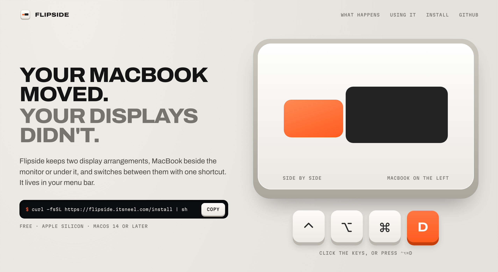

<picture>
  <source media="(prefers-color-scheme: dark)" srcset="docs/hero-dark.png" />
  
</picture>

# Flipside

**Your MacBook moved. Your displays didn't.** Flipside keeps two display arrangements, MacBook beside the monitor or under it, and switches between them with one shortcut. It lives in your menu bar.

**[Try it at flipside.itsneel.com](https://flipside.itsneel.com)** · [Latest release](https://github.com/Neel2107/Flipside/releases/latest)

## Install

```sh
curl -fsSL https://flipside.itsneel.com/install | sh
```

Requires an Apple silicon Mac on macOS 14 or later. The installer verifies the release checksum and puts Flipside in `/Applications`. Run the same command again to update. It serves this repository's `scripts/install.sh`, which you can also run straight from GitHub:

```sh
curl -fsSL https://raw.githubusercontent.com/Neel2107/Flipside/main/scripts/install.sh | sh
```

The app is ad-hoc signed and not notarised; the installer clears the quarantine flag so it opens normally. No permissions are needed: display arrangement and the global shortcut both use APIs that work without Accessibility or Screen Recording access.

## Why

macOS remembers one arrangement for a pair of displays. Slide your MacBook from beside the monitor to under it, and your pointer still leaves through the wrong edge until you open System Settings and drag a rectangle. Flipside keeps both arrangements, one shortcut apart.

## What happens when you flip

- **A confirmation where you're looking.** Rearranging displays moves nothing you can see, so each flip shows a brief confirmation on the screen your pointer is on, not always the main one.
- **Your pointer stays on its screen.** macOS keeps the pointer's coordinates when screens move, which can leave it on the wrong display or on none. Flipside puts it back on the same spot of the same screen.
- **The same shape at any resolution.** Positions are stored as a share of the shared edge, not in points, so "centred" stays centred if you change either display's resolution.
- **An icon that shows the arrangement.** The menu bar icon draws the layout you're in and reshapes itself when it changes. It dims while only one display is connected.
- **Nothing else moves.** The display with the menu bar stays the main display in both arrangements, so the menu bar and Dock never jump screens.

## Using it


| To | Do this |
| --- | --- |
| Pick an arrangement | Click the menu bar icon, then a card (or press `1` / `2`) |
| Flip to the other one | Right-click, Control-click or Option-click the icon, or press `⌃⌥⌘D` anywhere |
| Change the shortcut | Click the keycaps in the panel and press a new combination (`Esc` cancels, `Delete` removes it) |
| Start with your Mac | Turn on **Launch at login** in the panel |

<br clear="right" />

### The two layouts

Out of the box:

- **Side by side** — built-in display to the left of the external one, sitting about 70% of the way down.
- **Stacked** — built-in display underneath, slightly right of centre.

These were measured from screenshots, so they are within a few points of the originals rather than exact. The first time Flipside sees your real arrangement it snaps the matching layout to it exactly.

To use a different arrangement for either slot, set it up once in System Settings → Displays → Arrange, then open the panel and choose **Save as**, or right-click a card and choose **Use Current Arrangement**. **Reset to Default** on the same menu undoes that.

### Scope

Flipside arranges exactly two displays. With one display, mirrored displays, or three or more, the panel says so and the layouts are disabled.

## From source

Needs the Xcode Command Line Tools (`xcode-select --install`); Xcode itself is not required.

```sh
make install
```

That builds `build/Flipside.app`, copies it to `/Applications` and launches it. `make app` only builds; `make run` builds and launches from the build folder.

## Development

```sh
make test      # unit tests for the geometry (Swift Testing)
make e2e       # runs the real arrangement code against a temporary virtual display
make previews  # renders the panel, HUD and icon in every state to build/previews
```

`make e2e` needs exactly one real display connected. It adds a virtual 2560 × 1440 display for a few seconds using the private `CGVirtualDisplay` API, rearranges it, and checks where everything landed. To try the app by hand without a second monitor:

```sh
swift run flipside-e2e --stand-in 60
```

The app icon is drawn by `swift scripts/make-icon.swift Resources/AppIcon.icns`.

Layout:

- `Sources/FlipsideCore` — arrangement geometry and the CoreGraphics calls (`CGConfigureDisplayOrigin`). No UI.
- `Sources/Flipside` — the menu bar app: status item, SwiftUI panel, HUD, global shortcut.
- `Tools/` — the virtual display harness. Not part of the app.
- `website/` — the site at flipside.itsneel.com, which every push to `main` deploys. See [website/README.md](website/README.md).
